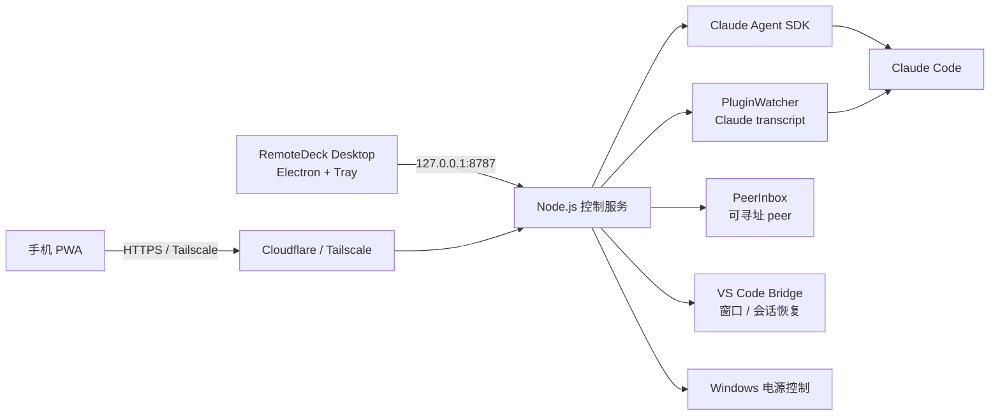

# RemoteDeck

[](https://github.com/Rylin512/remotedeck/releases)


**把电脑上的 Claude Code、VS Code 与电源控制装进手机和桌面。**

RemoteDeck 在 Windows 本机运行一个小型控制服务：手机浏览器通过 Cloudflare 或 Tailscale 访问它，就能实时查看 Claude Code 的执行过程、继续历史对话、向正在运行的 VS Code 插件会话发消息，以及关机、重启和关闭 VS Code 窗口。桌面版则用独立窗口和系统托盘提供同样的控制台，不占用浏览器标签。

## 目录

- [项目简介](#项目简介)
- [功能特性](#功能特性)
- [系统架构](#系统架构)
- [快速开始](#快速开始)
- [桌面版与系统托盘](#桌面版与系统托盘)
- [Android App](#android-app)
- [手机连接](#手机连接)
- [Claude Code 集成](#claude-code-集成)
- [项目结构](#项目结构)
- [构建安装包](#构建安装包)
- [自检与验证](#自检与验证)
- [数据与安全](#数据与安全)
- [常见问题](#常见问题)
- [贡献](#贡献)
- [许可证](#许可证)

## 项目简介

日常使用 Claude Code 时，真正需要盯着屏幕的往往只是「它现在做到哪一步了」「这个权限要不要批准」「这个任务要不要打断」。RemoteDeck 把这些操作从电脑前移开：

- **实时监视**：读取 Claude Code 扩展写入的本机会话文件，逐秒同步文本、思考状态、工具调用和工具结果；
- **实时介入**：向正在运行的 VS Code 插件会话发送微调消息，或以 `priority=now` 直接打断；
- **历史续接**：浏览最近会话或全部历史记录，继续原对话；对应 VS Code 窗口没开时自动拉起并恢复；
- **电脑控制**：远程关机、重启、锁定、睡眠、取消关机，关闭指定 VS Code 窗口；
- **桌面壳**：Electron 独立窗口 + 系统托盘，关闭窗口只隐藏到托盘；
- **零公网 IP**：Cloudflare Quick Tunnel 或 Tailscale，不配置路由器端口映射。

所有 Claude 会话、代码和配置都在你自己的电脑上运行，RemoteDeck 只做本机控制面。

## 功能特性

| 能力 | 说明 |
|---|---|
| 实时插件会话 | 监视 VS Code 中正在运行的 Claude Code 会话；只有进程仍存活的会话才出现在实时列表 |
| 微调 / 打断 | `nudge` 在下一个工具边界或回合被读取；`interrupt` 以 `priority=now` 中断当前回合 |
| 工具步骤标题 | Bash 显示描述或命令摘要，Read/Edit 显示路径，Todo/任务/MCP 等都有标题；长标题省略不溢出 |
| 思考状态 | 显示「Claude 正在思考 / 正在执行工具 / 正在输出」和 token 用量，不展开思考正文 |
| 会话状态 | 「正在对话 / 历史对话」跟随 SSE 事件即时更新，不依赖慢缓存 |
| 选择题回答 | Claude 使用 AskUserQuestion 时，手机端可选择选项、多选或填写「其他」自定义答案 |
| 防止熄屏 | 默认开启手机屏幕常亮；HTTP 下使用静音视频兼容模式，HTTPS 使用系统 Wake Lock |
| 断线恢复 | 手机熄屏/切后台再回来后自动重连 SSE 并重新拉取会话，补齐漏掉的消息 |
| 消息流畅 | 流式文本按动画帧批量合并渲染，减少每 token 的 DOM 重排 |
| 大对话快速进入 | 首次只读取最近 120 条消息，顶部「加载更早」按需继续；JSON 与前端资源 gzip 传输 |
| 透明底栏 | 手机端底部导航和输入区去掉整块黑色背景，改为透明悬浮在页面渐变上 |
| 消息去重 | 重新进入插件会话时，手机发出的消息与 transcript 中的副本自动合并，不再堆在底部 |
| 全部历史 | 「显示全部记录」合并 SDK 会话列表与本地 transcript，包含 SDK 可能漏掉的记录 |
| 自动恢复 | 继续历史会话时自动判断：复用运行中的会话、聚焦已有 VS Code 窗口、或拉起新窗口后恢复 |
| VS Code 控制 | 列出正在运行的 VS Code 窗口并远程关闭；有未保存内容时由 VS Code 自己弹保存确认 |
| 插件回复 | RemoteDeck 注册为可寻址的本地 peer，插件 Claude 的回复能回到 RemoteDeck |
| 电源控制 | 关机、重启、锁定、睡眠、取消关机；延时执行，中文确认词，审计留痕 |
| 桌面版 | Electron 独立窗口、任务栏托盘、单击呼出、右键操作、单实例、退出时关闭内置服务 |
| Android App | WebView 独立应用；扫码添加设备、Cookie 保持登录、多设备切换、多窗口分屏 |
| 一键安装 | NSIS 安装包内置 Electron 与 Node 运行时，目标电脑无需安装 Node 或项目目录 |
| 远程访问 | Cloudflare Quick Tunnel、Tailscale Serve/Tailscale IP 直连、本机/局域网监听 |
| 零运行时依赖 | 安装版自带 Node/Electron；源码运行需要 Node.js 20+ |

## 系统架构



设计原则：

- **本机控制面**：服务默认只监听 `127.0.0.1`，需要手机访问时再显式开启隧道；
- **源码只读**：监视插件 transcript 不会修改 Claude 会话文件；发送消息走 Claude Code 的本地跨会话通道；
- **最小权限**：会话操作、VS Code 窗口关闭和电源操作都需要登录、CSRF 和显式确认；
- **可恢复**：安装版卸载默认保留配置和历史数据，重装后仍可登录。

## 快速开始

### 环境要求

| 项目 | 要求 |
|---|---|
| 操作系统 | Windows 10/11 x64 |
| 安装版 | 无额外运行时要求，安装包内置 Electron 与 Node |
| 源码运行 | Node.js 20+（推荐 22/24）、npm |
| Claude Code | 已安装并登录 Claude Code（VS Code 扩展或 CLI 均可） |
| VS Code | 可选；用于插件监视、窗口控制和会话恢复 |
| 权限 | 普通用户即可，不需要管理员权限 |

### 方式一：安装版（推荐）

从 [Releases](https://github.com/Rylin512/remotedeck/releases) 下载 `RemoteDeck-0.1.0-setup.exe`，双击安装。

安装完成后会自动创建：

- 桌面快捷方式：**RemoteDeck**
- 开始菜单快捷方式：**RemoteDeck**
- 卸载入口：Windows 设置 → 应用 → RemoteDeck，或安装目录中的 `Uninstall RemoteDeck.exe`

> 安装包没有代码签名，Windows SmartScreen 可能提示「未知发布者」，选择「更多信息 → 仍要运行」即可。安装包请放在 ASCII 路径运行。

### 方式二：源码运行

```powershell
cd <RemoteDeck 源码目录>
npm install
npm run desktop
```

只启动服务、不打开桌面窗口：

```powershell
npm start
```

服务默认监听 `http://127.0.0.1:8787`。第一次打开时设置登录密码；密码只保存在本机 `%LOCALAPPDATA%\RemoteDeck\state.json`。

```text
RemoteDeck 已启动
本机: http://127.0.0.1:8787
首次使用: 在本地浏览器打开上面的地址，设置密码。
```

## 桌面版与系统托盘

桌面版是一个独立 Electron 窗口，不经过浏览器标签页：

- 关闭窗口只隐藏到托盘，服务继续运行；
- 单击托盘图标呼出窗口；
- 右键菜单：打开 RemoteDeck、在浏览器中打开、复制访问地址、重新加载界面、打开数据目录、退出；
- 已运行时会阻止重复实例，再次双击只呼出已有窗口；
- 退出托盘应用会优雅关闭内置 Node 服务；
- 桌面窗口启用 GPU 加速，并去掉了高开销背景模糊，滚动和输入更流畅。

从源码启动桌面版：

```powershell
npm run desktop
```

首次运行且项目路径包含中文时，会把 Electron 运行时缓存到 `%LOCALAPPDATA%\RemoteDeck\runtime\`，以避开 Chromium 对非 ASCII 路径的兼容问题；安装版不受此影响。

## Android App

从 [Releases](https://github.com/Rylin512/remotedeck/releases) 下载 `RemoteDeck-Android-0.1.0.apk`，侧载安装。

- 首次打开扫描电脑上 RemoteDeck 显示的二维码，自动保存地址。
- 登录一次后 WebView Cookie 会保留，下次启动直接进入最近设备。
- 首页可保存多台电脑；顶部「设备」切换，「多开」创建独立任务，可配合 Android 分屏。
- 地址属于 Tailscale（`100.64.0.0/10` 或 `*.ts.net`）时，会尝试发送 Tailscale `CONNECT_VPN` 广播并延迟加载；失败时显示「打开 Tailscale」。
- Android 不允许普通 App 强制开启另一个 App 的 VPN。若广播被系统忽略，请把 Tailscale 设为「始终开启的 VPN」，或每次从 App 内打开 Tailscale。
- APK 为 debug 签名，适合个人侧载，不适合上架应用商店。

源码在 [`android/`](android/)，构建方法见 [android/README.md](android/README.md)。

## 手机连接

### Cloudflare Quick Tunnel（最省事）

1. 手机和电脑都能上网；
2. 打开 RemoteDeck → **设置 → 远程访问**；
3. 连接方式选 **Cloudflare 快速隧道**，点击 **启动隧道**；
4. 首次会自动下载 `cloudflared.exe`，然后生成 `https://xxxx.trycloudflare.com`；
5. 手机扫码或打开地址，输入本机密码。

快速隧道地址随机且会变化，适合临时使用；长期稳定请用 Tailscale。

### Tailscale（推荐，稳定且不暴露公网）

1. 电脑和手机安装 Tailscale 并登录同一账号；
2. 设置 → 远程访问 → 连接方式选 **Tailscale** → 启动；
3. 应用优先使用 `tailscale serve`，不可用时回退到 Tailscale IP 直连；
4. 手机通过显示的 `https://...ts.net/` 或 `http://100.x.x.x:8787/` 访问。

### 局域网

在设置中把监听地址改为 `0.0.0.0`，手机用电脑的局域网 IP 访问。仅建议在可信网络使用。

## Claude Code 集成

### 实时插件会话

RemoteDeck 监视 `~/.claude/projects/**/*.jsonl`：

- 每秒检查增量，不修改 transcript；
- 只显示 Claude 进程仍在运行的会话；
- 会话退出或 VS Code 窗口关闭后自动从实时列表移除；
- 支持微调、直接打断、关闭会话、查看工具标题和思考 token。

### 继续历史会话

点击「继续」时：

- 会话仍在运行：直接进入实时发送界面；
- 会话已结束但 VS Code 窗口还在：聚焦已有窗口并恢复；
- 对应窗口没开：自动启动该项目窗口，等待桥接就绪后恢复；
- 桥接不可用：回退到 RemoteDeck 自带的 Claude 会话。

启动前会清除继承的 `ELECTRON_RUN_AS_NODE`，避免 `Code.exe` 被当成 Node 运行。

### VS Code 桥接

`vscode-bridge/` 是一个轻量 VS Code 扩展，提供：

- 打开 Claude Code 面板；
- 在已有窗口恢复指定 session；
- 打开文件/目录；
- 向 Claude Code 终端发送短指令（实验性）。

```powershell
npm run bridge:install
```

安装或更新后需要执行一次 **Developer: Reload Window**。

### 插件回复回传

RemoteDeck 启动时注册一个名为 `RemoteDeck` 的本地 peer inbox。插件 Claude 回复发送方时会回到 RemoteDeck，而不是误发到其他会话；手机界面显示「插件回复」提示。

## 项目结构

```text
remotedeck/
├── desktop/
│   └── main.cjs                Electron 窗口、托盘、内置服务生命周期
├── server/
│   ├── index.js                HTTP API、SSE、静态文件、认证
│   ├── auth.js                 密码、Cookie、CSRF、限流
│   ├── config.js               数据目录、设置、审计
│   ├── claude/
│   │   ├── manager.js          Claude SDK 会话、历史、权限
│   │   ├── plugin-watcher.js   VS Code 插件 transcript 增量监视
│   │   ├── normalize.js        SDK / transcript 事件标准化
│   │   ├── peer.js             跨会话消息投递
│   │   ├── peer-inbox.js       可寻址 RemoteDeck peer
│   │   └── plugin-close.js     关闭插件会话进程
│   └── system/
│       ├── tunnel.js           Cloudflare / Tailscale
│       ├── vscode.js           VS Code 桥接与窗口/会话
│       ├── vscode-windows.js   窗口枚举、聚焦、关闭
│       ├── power.js            电源操作
│       └── metrics.js          CPU / 内存 / 磁盘
├── public/                     手机 PWA 与桌面页面
├── assets/                     应用图标、安装包图标
├── scripts/                    安装、构建、图标、桌面启动脚本
├── vscode-bridge/              VS Code 桥接扩展源码
├── tests/                      Node 自动化测试
├── package.json
└── LICENSE
```

## 构建安装包

```powershell
npm install
npm run build:desktop
```

构建会：

1. 把当前 Node 运行时复制到 `desktop/runtime/node.exe`；
2. 用 electron-builder 打出 NSIS 安装包；
3. 把安装包复制到 ASCII 路径 `%LOCALAPPDATA%\RemoteDeck\RemoteDeck-Setup.exe`，避免项目中文路径导致安装器异常。

产物：

- `dist/RemoteDeck-0.1.0-setup.exe`
- `%LOCALAPPDATA%\RemoteDeck\RemoteDeck-Setup.exe`

可选构建：

```powershell
npm run build:desktop:installer   # NSIS 安装包
npm run icon:generate              # 重新生成图标
```

## 自检与验证

```powershell
npm run check     # 语法检查
npm test          # 35 个自动化测试
npm run desktop   # 桌面版
```

测试覆盖：密码/会话/CSRF、登录限流、消息标准化、工具标题、thinking token、插件 JSONL 增量监视、peer 消息、插件关闭、电源确认、HTTP 鉴权流程等。

## 数据与安全

- 配置与登录数据：`%LOCALAPPDATA%\RemoteDeck\state.json`
- Claude transcript：`~/.claude/projects/`
- 安装目录：`%LOCALAPPDATA%\Programs\RemoteDeck`
- 安装版卸载默认保留配置，重装后仍可登录
- 密码使用 scrypt 哈希；会话 Cookie 为 HttpOnly/SameSite=Strict；修改类请求要求 CSRF
- 电源和关闭窗口操作需要登录及显式确认
- 不要把 RemoteDeck 端口直接暴露到公网；优先使用 Tailscale 或 Cloudflare Tunnel
- 本项目可以远程控制电脑，请只在自己信任的设备上登录

## 常见问题

**手机打不开地址？**

先用电脑本机打开 `http://127.0.0.1:8787` 确认服务正常，再检查隧道状态。Cloudflare 地址首次生效可能需要 30–90 秒。

**插件会话显示「会话已结束」？**

Claude 进程已退出；可点击「继续」让 RemoteDeck 自动拉起 VS Code 窗口并恢复，或回退到 RemoteDeck 会话。

**关闭窗口后应用不见了？**

RemoteDeck 默认关闭到系统托盘。单击托盘图标，或右键选择「打开 RemoteDeck」。退出请使用托盘菜单。

**安装包提示未知发布者？**

安装包未做代码签名，这是 Windows SmartScreen 的正常提示。确认来源后选择「仍要运行」。

**token 数量为什么带「约」？**

部分模型不返回精确的 `thinking_tokens`，此时按思考文本长度估算并标注「约」；返回精确值时直接显示数字。

**数据会随卸载删除吗？**

默认不会。卸载应用保留 `%LOCALAPPDATA%\RemoteDeck\state.json`；需要彻底清除时手动删除该目录。

## 贡献

欢迎通过 [Issues](https://github.com/Rylin512/remotedeck/issues) 反馈问题。提交改动前建议运行：

```powershell
npm run check
npm test
```

涉及桌面壳、VS Code 桥接或安装包的改动，请同时验证桌面窗口、托盘隐藏/恢复和打包产物。

## 许可证

本项目使用 [MIT License](LICENSE)。HTTP 下的屏幕常亮兼容模式使用 [NoSleep.js](https://github.com/richtr/NoSleep.js)（MIT）。
